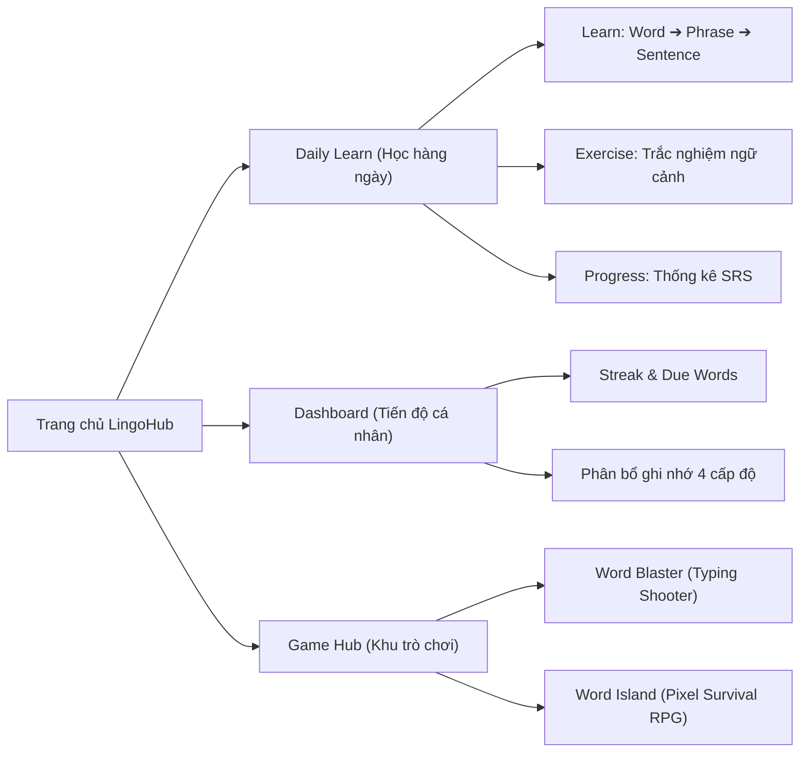

# LINGOHUB: Daily Learn & Game Hub

**LingoHub** là nền tảng học tiếng Anh hiện đại kết hợp giữa **Học tập vi mô mỗi ngày (Micro-learning & Spaced Repetition)** và **Học qua trò chơi tương tác (Game-based Learning)**.

Mục tiêu cốt lõi của dự án là xây dựng một lộ trình học tập tự nhiên, bền vững và hào hứng:

> **`Word (Từ vựng) ➔ Phrase (Cụm từ / Collocation) ➔ Sentence (Câu ngữ cảnh) ➔ Practice & Game (Thực hành & Trò chơi)`**

---

## Bản đồ Tài liệu chi tiết (Documentation Map)

Để thuận tiện cho việc phát triển và bảo trì mã nguồn theo từng module, các tài liệu kỹ thuật chi tiết đã được phân tách vào đúng thư mục tương ứng:

| Phân hệ / Module | Vị trí tài liệu chi tiết                                                     | Trạng thái            | Mô tả tóm tắt                                                                                                                                    |
| :--------------- | :--------------------------------------------------------------------------- | :-------------------- | :----------------------------------------------------------------------------------------------------------------------------------------------- |
| **Daily Learn**  | [`src/app/daily-learn/README.md`](src/app/daily-learn/README.md)             | ✅ Hoàn thiện         | Luồng học 3 bước (Word ➔ Phrase ➔ Sentence), bài tập trắc nghiệm ngữ cảnh, cơ chế Review Mistakes và thuật toán lặp lại ngắt quãng SRS.          |
| **Word Blaster** | [`src/app/game/word-blaster/README.md`](src/app/game/word-blaster/README.md) | ✅ Hoàn thiện 100%    | Game Arcade Typing Shooter: Bắn nổ từ vựng đang rơi bằng tốc độ gõ phím, tia laser khóa mục tiêu động, hệ số nhân Combo và âm thanh Web Audio.   |
| **Word Island**  | [`src/app/game/word-island/README.md`](src/app/game/word-island/README.md)   | ✅ Hoàn thiện 100% | Game RPG 2D Pixel-art: Khám phá hoang đảo trên Canvas thời gian thực, chặt cây đập đá sinh tồn, hội thoại NPC và giải đố từ vựng mở Cổng Cổ Đại. |

---

## Tổng quan các tính năng chính (Core Features)



### 1. Luồng học tập hằng ngày (Daily Learn)

- **Học từ vựng vi mô (`/daily-learn/learn`)**: Tự động chọn 10 từ/ngày (ưu tiên từ đến hạn ôn). Học qua 3 thẻ nối tiếp: Thẻ từ vựng IPA kèm Text-to-Speech (`WordCard`), Thẻ cụm từ đi kèm (`PhraseList`), Thẻ câu ví dụ ngữ cảnh (`ExampleSentence`).
- **Luyện tập phản xạ (`/daily-learn/exercise`)**: Trắc nghiệm điền khuyết dựa trên ngữ cảnh thực tế. Cơ chế **Review Mistakes** bắt buộc ôn lại các từ làm sai trước khi hoàn thành.
- **Thuật toán Spaced Repetition (SRS)**: Tự động điều chỉnh chu kỳ ngày ôn (`1, 3, 7, 14, 30 ngày`) và phân loại từ vựng thành 4 cấp độ ghi nhớ (_New, Learning, Remembering, Mastered_).
- Chi tiết xem tại: 🔗 [`src/app/daily-learn/README.md`](src/app/daily-learn/README.md).

### 2. Bảng điều khiển cá nhân (Dashboard - `/dashboard`)

- **Theo dõi Streak**: Đếm chuỗi ngày học liên tục để duy trì thói quen học tập.
- **Hero Banner**: Lời chào cá nhân hóa và đếm số lượng từ vựng đến hạn ôn tập trong ngày.
- **Thẻ dữ liệu thông minh**: Thống kê tổng số từ đã học, tỷ lệ thành thạo và phân bổ ghi nhớ.
- **Lối tắt nhanh (Action Cards)**: Điều hướng tức thì vào bài học hôm nay, bài tập ôn luyện hoặc khu trò chơi.

### 3. Khu vực Trò chơi (Game Hub - `/game`)

Dự án hiện có **02 tựa game** hoàn chỉnh hỗ trợ rèn luyện từ vựng qua phản xạ và giải đố:

- **Word Blaster (`/game/word-blaster`)**: Game gõ phím bắn từ vựng phong cách không gian retro. Người chơi gõ chữ để ngắm bắn laser phá hủy từ đang rơi, nhân hệ số Combo Multiplier và bảo vệ thanh sinh lực (Lives). Chi tiết xem tại 🔗 [`src/app/game/word-blaster/README.md`](src/app/game/word-blaster/README.md).
- **Word Island (`/game/word-island`)**: Game nhập vai sinh tồn 2D Pixel-art trên Canvas thời gian thực. Người chơi di chuyển tự do bằng phím WASD, khai thác Gỗ và Đá, trò chuyện với Thuyền trưởng Minh và giải đố từ vựng để mở Cổng Cổ Đại sửa thuyền. Chi tiết xem tại 🔗 [`src/app/game/word-island/README.md`](src/app/game/word-island/README.md).

### 4. Hệ thống Xác thực & Bảo mật toàn diện (Security & Auth)

- **Next.js 16 Native Middleware (`src/proxy.ts`)**:
  - Trong Next.js 16, convention `middleware.ts` chính thức được đổi tên thành `proxy.ts`.
  - Tích hợp chuẩn `@supabase/ssr` đồng bộ cookie session giữa browser và server, bảo vệ các route riêng tư (`/dashboard`, `/daily-learn/*`, `/game/word-blaster`).
  - Matcher loại trừ toàn bộ static assets (`_next/static`, `_next/image`, `.png`, `.svg`,...) đảm bảo 100% tốc độ render tĩnh (Static Optimization).
- **Chống cào dữ liệu học liệu (Anti-Scraping RLS)**:
  - Các bảng `vocabulary`, `exercise_questions`, `topics`, `topic_vocabulary` được thiết lập RLS **chỉ cho phép `authenticated` users** được đọc dữ liệu. Người dùng ẩn danh (anon) hoặc script crawl ngoài không thể đọc trộm dữ liệu.
- **Chống gian lận điểm số & Chuỗi ngày học (Server-side Anti-Cheat)**:
  - **Database Trigger (`validate_user_learning_stats`)**: Ngăn chặn người dùng mở F12 can thiệp database; nghiêm cấm tăng `streak_count` vượt quá +1/ngày và chặn ghi ngày học ở tương lai.
  - **Server-Side RPC (`record_word_review`)**: Tính toán SRS (`streak`, `interval_days`, `due_at`) và chuỗi ngày học hoàn toàn tại PostgreSQL server.
- **Hạn chế tần suất request (Rate Limiting)**:
  - **Database Layer**: Trigger Postgres giới hạn tối thiểu 200ms giữa các lượt ghi của cùng một user.
  - **Client Layer**: Hàm `throttleRequest()` 250ms trong `LearningProgressService` ngăn ngừa spam request.

---

## Tech Stack

- **Framework**: Next.js 16 (App Router & Turbopack)
- **Ngôn ngữ**: TypeScript 5
- **Giao diện**: React 19, Tailwind CSS v4, Lucide Icons, Sonner Toast
- **State Management**: Zustand v5
- **Đồ họa & Âm thanh Game**: HTML5 Canvas 2D API, Web Audio API, Web Speech Synthesis API
- **Backend & Database**: Supabase (PostgreSQL, Row Level Security, `@supabase/ssr`)

---

## Cấu trúc thư mục tổng thể (Folder Structure)

```text
├── src/
│   ├── proxy.ts                    # Next.js 16 Native Middleware: Bảo vệ route & đồng bộ auth cookie
│   ├── app/
│   │   ├── auth/                   # Màn hình Đăng nhập / Đăng ký (Email & Google OAuth)
│   │   │   ├── callback/route.ts   # Xử lý PKCE OAuth Callback từ Supabase
│   │   │   └── page.tsx
│   │   ├── dashboard/              # Bảng điều khiển cá nhân & chỉ số Streak
│   │   ├── daily-learn/            # Phân hệ Daily Learn (có README.md riêng)
│   │   │   ├── README.md           # Tài liệu chi tiết Daily Learn & thuật toán SRS
│   │   │   ├── learn/page.tsx      # Bước 1: Học từ (Word -> Phrase -> Sentence)
│   │   │   ├── exercise/page.tsx   # Bước 2: Bài tập ngữ cảnh & Review Mistakes
│   │   │   └── progress/page.tsx   # Bước 3: Thống kê SRS cá nhân
│   │   ├── game/                   # Khu vực Game Hub
│   │   │   ├── page.tsx            # Thư viện chọn game (Game Library)
│   │   │   ├── word-blaster/       # Game Word Blaster (có README.md riêng)
│   │   │   │   ├── README.md       # Tài liệu chi tiết Word Blaster & cơ chế bắn từ
│   │   │   │   └── page.tsx
│   │   │   └── word-island/        # Game Word Island (có README.md riêng)
│   │   │       ├── README.md       # Tài liệu chi tiết Word Island & cơ chế sinh tồn RPG
│   │   │       └── page.tsx
│   │   ├── layout.tsx & globals.css
│   │   └── page.tsx                # Landing Page chính của LingoHub
│   ├── components/
│   │   ├── AuthPage.tsx            # Form đăng nhập/đăng ký & tích hợp Google OAuth
│   │   ├── AuthProvider.tsx        # Context chia sẻ Session & tải lịch ôn cá nhân
│   │   ├── WordCard.tsx, PhraseList.tsx, ExampleSentence.tsx, ExerciseCard.tsx
│   │   ├── dashboard/              # Các widget Dashboard (Hero, Stats, Memory, Action)
│   │   ├── word-island/            # Components UI của Word Island (Hud, Dialog, Quiz, Victory)
│   │   └── home/                   # Các section trên Landing Page
│   ├── hooks/
│   │   ├── useGameEngine.ts        # Vòng lặp tính toán tọa độ, va chạm, combo cho Word Blaster
│   │   └── useWordIsland.ts        # Quản lý game loop Canvas, tương tác vật thể cho Word Island
│   ├── stores/
│   │   ├── learningStore.ts        # Quản lý trạng thái học từ & bài tập (Zustand)
│   │   └── wordIslandStore.ts      # Quản lý inventory, nhiệm vụ, ngày đêm của Word Island
│   ├── services/
│   │   ├── apiClient.ts            # Khởi tạo browser Supabase client
│   │   ├── authService.ts          # Gọi API đăng nhập, đăng ký, đăng xuất, OAuth
│   │   ├── learningService.ts      # Truy vấn kho từ vựng và câu hỏi bài tập
│   │   └── learningProgressService.ts # Đọc/ghi tiến trình SRS và Streak an toàn qua RPC
│   └── utils/
│       ├── audio.ts                # Bộ phát âm thanh hiệu ứng game (Web Audio)
│       ├── speech.ts               # Bộ đọc phát âm từ vựng (Text-to-Speech)
│       ├── wordIslandRenderer.ts   # Render vòng lặp đồ họa Canvas pixel-art
│       └── wordIslandData.ts       # Bản đồ tile, tọa độ cây cối, mỏ đá và NPC đảo
└── supabase/
    └── migrations/                 # Các tệp SQL khởi tạo bảng, RLS, Anti-cheat và Rate limiting
```

---

## Hướng dẫn Cài đặt & Khởi chạy (Quick Start)

### 1. Yêu cầu môi trường

- **Node.js**: Phiên bản 18+ trở lên
- **Trình duyệt**: Khuyến nghị Google Chrome, Microsoft Edge hoặc Safari phiên bản mới.

### 2. Cài đặt Dependencies

```bash
npm install
# hoặc
yarn install
```

### 3. Cấu hình Biến môi trường (`.env.local`)

Tạo file `.env.local` tại thư mục gốc với các thông tin từ Supabase:

```env
NEXT_PUBLIC_SUPABASE_URL=https://your-project-id.supabase.co
NEXT_PUBLIC_SUPABASE_ANON_KEY=your-supabase-publishable-or-anon-key
```

### 4. Thiết lập Supabase Database

1. Truy cập **Supabase Dashboard → SQL Editor**.
2. Thực thi lần lượt các file migration trong thư mục `supabase/migrations/`:
   - `20261007000000_initial_schema.sql`: Schema khởi tạo bảng từ vựng và câu hỏi bài tập.
   - `20261012000000_user_learning_progress.sql`: Bảng `user_word_progress` theo dõi tiến trình SRS từng user với Row Level Security.
   - `20261016000000_user_learning_stats.sql`: Khởi tạo bảng thống kê học tập và đếm streak.
   - `20261021000000_security_and_rate_limits.sql`: Bảo mật RLS chống cào dữ liệu (Authenticated only), chống gian lận streak (tối đa +1/ngày), rate limiting và hàm RPC `record_word_review`.
3. Trong **Authentication → URL Configuration**:
   - Thêm Redirect URL: `http://localhost:3000/auth/callback` và `http://localhost:3000/auth`.

### 5. Khởi chạy ứng dụng

```bash
npm run dev
```

Mở trình duyệt và truy cập `http://localhost:3000` để bắt đầu trải nghiệm LingoHub!
