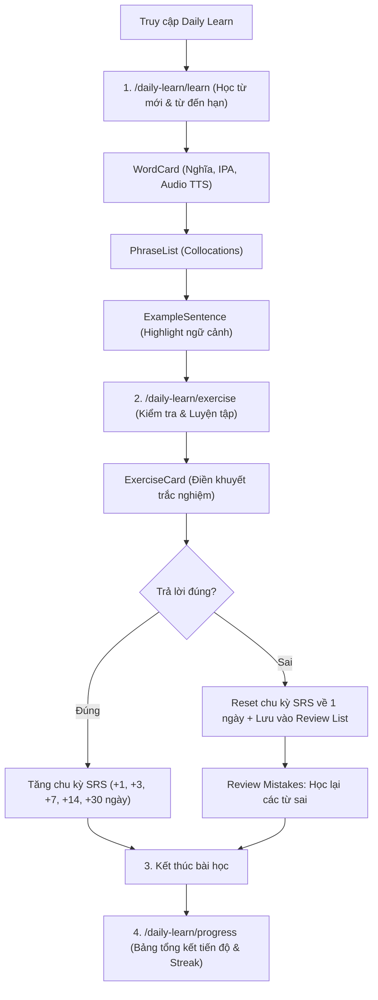

# Phân hệ Daily Learn (Học tập hàng ngày)

Phân hệ **Daily Learn** là trái tim học thuật của LingoHub, được thiết kế theo phương pháp **Micro-learning (Học tập vi mô)** kết hợp thuật toán **Spaced Repetition System (SRS - Lặp lại ngắt quãng)** nhằm tối ưu hóa khả năng ghi nhớ từ vựng dài hạn.

---

## Triết lý & Lộ trình học 4 bước

Thay vì học từ vựng rời rạc, Daily Learn dẫn dắt người học qua lộ trình tự nhiên:

1. **Word (Từ vựng)**: Nhận biết mặt chữ, phát âm chuẩn IPA, loại từ và nghĩa cốt lõi.
2. **Phrase (Cụm từ / Collocation)**: Nắm bắt các cụm từ thường đi kèm trong đời sống thực tế.
3. **Sentence (Câu ví dụ ngữ cảnh)**: Đọc hiểu ngữ cảnh ứng dụng của từ vựng qua câu ví dụ có highlight.
4. **Contextual Practice (Thực hành ngữ cảnh)**: Trắc nghiệm điền từ và đánh giá khả năng phản xạ qua bài tập thực tế.

---

## Cấu trúc luồng màn hình (User Flow)



---

## Chi tiết các chức năng

### 1. Học từ vựng (`/daily-learn/learn`)

- **Tự động chọn bài học**: Mỗi ngày hệ thống chọn tối đa 10 từ vựng từ cơ sở dữ liệu Supabase, ưu tiên các từ đến hạn ôn tập (`due_at <= now()`) trước khi nạp thêm từ mới.
- **Thẻ học tương tác (Micro-cards)**:
  - `WordCard`: Hiển thị từ vựng, cấp độ (A1-B2), phiên âm IPA và nghĩa chính. Tích hợp nút phát âm qua Web Speech Synthesis API.
  - `PhraseList`: Danh sách các cụm từ phổ biến (Collocations) đi kèm giúp tránh dịch từng từ (word-by-word).
  - `ExampleSentence`: Câu ví dụ ngữ cảnh thực tế kèm bản dịch tiếng Việt, tô sáng từ vựng mục tiêu.
- **Thanh tiến trình (`ProgressBar`)**: Thể hiện trực quan tiến độ học của phiên học hiện tại.

### 2. Luyện tập & Đánh giá (`/daily-learn/exercise`)

- **Bài tập ngữ cảnh (`ExerciseCard`)**:
  - Không hỏi nghĩa đơn thuần mà đưa ra tình huống thực tế với câu chứa chỗ trống `____`.
  - 4 lựa chọn trắc nghiệm được xáo trộn ngẫu nhiên.
  - Phản hồi trực quan tức thì: Nút đổi màu Xanh (Đúng) hoặc Đỏ (Sai), hiển thị giải thích đáp án chuẩn.
- **Cơ chế Review Mistakes**:
  - Tự động thu thập ID các từ trả lời sai trong phiên làm bài.
  - Bắt buộc người học xem lại các thẻ `WordCard` của những từ này trước khi hoàn thành phiên học.
- **Bảng điểm tổng kết (ASCII/Retro Box)**:
  - Điểm số chính xác (Accuracy %).
  - Tổng số từ đã học, số câu đúng/sai và thời gian hoàn thành.

### 3. Theo dõi tiến trình SRS (`/daily-learn/progress`)

- **Thuật toán Spaced Repetition (SRS)**:
  - Khoảng thời gian ôn tập: `[1, 3, 7, 14, 30 ngày]`.
  - Trả lời đúng liên tiếp sẽ đẩy ngày ôn xa hơn; trả lời sai lập tức đặt lại về `1 ngày`.
- **4 Cấp độ ghi nhớ**:
  - **New (Mới)**: Từ mới tiếp cận (chu kỳ $\le$ 3 ngày).
  - **Learning (Đang học)**: Đã ôn 1-2 lần.
  - **Remembering (Đang nhớ)**: Chu kỳ ôn từ 7 đến 14 ngày.
  - **Mastered (Thành thạo)**: Chu kỳ đạt mốc 30 ngày.
- **Theo dõi Streak**: Chuỗi ngày học liên tục được đồng bộ lên máy chủ, khích lệ tinh thần duy trì thói quen học mỗi ngày.

---

## Kiến trúc mã nguồn & Data Models

### 1. Cấu trúc tệp tin

```text
src/
├── app/daily-learn/
│   ├── learn/page.tsx         # Route học từ vựng (Word -> Phrase -> Sentence)
│   ├── exercise/page.tsx      # Route làm bài tập ngữ cảnh & Review
│   └── progress/page.tsx      # Route theo dõi thống kê SRS & tiến độ cá nhân
├── pages/
│   ├── DailyLearnPage.tsx     # Client controller cho luồng học từ vựng
│   └── ExercisePage.tsx       # Client controller cho luồng bài tập
├── components/
│   ├── WordCard.tsx           # Thẻ từ vựng & phát âm Web Speech API
│   ├── PhraseList.tsx         # Thẻ hiển thị collocations
│   ├── ExampleSentence.tsx    # Thẻ hiển thị câu ví dụ ngữ cảnh
│   ├── ExerciseCard.tsx       # Thẻ trắc nghiệm điền khuyết
│   └── ProgressBar.tsx        # Thanh tiến trình học
├── stores/
│   └── learningStore.ts       # Zustand store quản lý trạng thái học tập
├── services/
│   ├── learningService.ts     # Gọi Supabase đọc từ vựng và câu hỏi bài tập
│   └── learningProgressService.ts # Quản lý tiến trình SRS, streak, rate limiting
└── utils/
    ├── dailyLesson.ts         # Logic lọc từ mới và từ đến hạn ôn
    ├── exercise.ts            # Logic chấm điểm & xáo trộn câu hỏi
    ├── speech.ts              # Xử lý Text-to-Speech
    └── date.ts                # Tính toán khoảng cách ngày học
```

### 2. Các Data Models chính

```typescript
// Định nghĩa từ vựng đầy đủ
export type Vocabulary = {
  id: string;
  word: string;
  pronunciation: string;
  partOfSpeech: string;
  meanings: string[];
  commonPhrases: { phrase: string; meaning: string }[];
  examples: { sentence: string; translation: string }[];
  difficulty: "A1" | "A2" | "B1" | "B2";
  tags: string[];
};

// Định nghĩa câu hỏi bài tập ngữ cảnh
export type ExerciseQuestion = {
  id: string;
  wordId: string; // Khóa ngoại liên kết với Vocabulary.id
  context: string; // Ngữ cảnh gợi ý
  sentence: string; // Câu ví dụ chứa chỗ trống "____"
  options: string[]; // 4 đáp án lựa chọn
  correctAnswer: string;
};

// Tiến trình ôn tập SRS của từng từ theo user
export type ReviewRecord = {
  streak: number; // Số lần trả lời đúng liên tiếp
  intervalDays: number; // Chu kỳ ngày ôn (1, 3, 7, 14, 30)
  dueAt: string; // Thời điểm đến hạn ôn tiếp theo (ISO string)
};

// Thống kê tổng hợp của người dùng
export type UserLearningStats = {
  newWords: number;
  rememberingWords: number;
  learningWords: number;
  masteredWords: number;
  totalWords: number;
  dueWords: number;
  streakCount: number;
  lastStudyDate: string | null;
  streakTrackingEnabled: boolean;
};
```

---

## Cơ chế bảo mật & Chống gian lận

1. **Bảo vệ nội dung học liệu**: Bảng `vocabulary` và `exercise_questions` được thiết lập RLS chỉ cho phép người dùng đã xác thực (`authenticated`) truy vấn. Khách vãng lai không thể cào trộm dữ liệu.
2. **Server-side SRS & Anti-Cheat**: Điểm số và tiến trình được tính toán qua Stored Procedure `record_word_review` trên PostgreSQL Supabase; trigger `trg_validate_user_learning_stats` ngăn chặn F12 can thiệp tăng streak ảo quá +1/ngày.
3. **Rate Limiting**: Database giới hạn tối thiểu 200ms giữa các lần ghi tiến trình; Client áp dụng hàm `throttleRequest()` 250ms tránh spam request.
