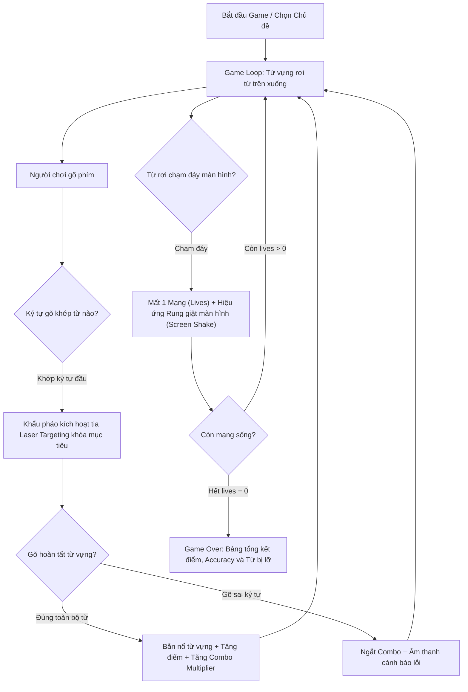

# Game Module: Word Blaster (Arcade Typing Shooter)

**Word Blaster** là tựa game hành động phản xạ nhanh kết hợp giữa cơ chế **Arcade Space Shooter** và **Luyện gõ bàn phím (Touch Typing)**, giúp người học ghi nhớ chính tả từ vựng tiếng Anh dưới áp lực thời gian thực đầy hào hứng.

---

## Trạng thái hiện tại (Status)

- **Trạng thái**: ✅ **Hoàn thiện 100% (Fully Playable)**.
- **Nền tảng tối ưu**: Desktop / Laptop (yêu cầu bàn phím cứng vật lý).
- **Hỗ trợ thiết bị**: Tự động nhận diện thiết bị di động (`userAgent` & màn hình nhỏ) để hiển thị màn hình cảnh báo [`MobileWarning`](../../../components/shared/MobileWarning.tsx), hướng dẫn người chơi trải nghiệm trên máy tính.

---

## Cơ chế lối chơi (Gameplay Mechanics)



### 1. Từ rơi liên tục (Falling Words)

- Các từ vựng thuộc chủ đề được chọn (Công nghệ, Đời sống, Kinh doanh,...) sẽ lần lượt xuất hiện từ phía trên màn hình và rơi dần xuống đáy.
- Tốc độ rơi tăng dần theo thời gian và điểm số của người chơi, đòi hỏi tốc độ gõ phím ngày càng chuẩn xác.

### 2. Khóa mục tiêu bằng Laser động (Dynamic Laser Targeting)

- Ngay khi người chơi bắt đầu gõ các chữ cái đầu tiên của một từ đang rơi, khẩu pháo phòng thủ ở đáy màn hình sẽ vẽ một **đường ngắm laser neon nối thẳng đến từ mục tiêu**.
- Hiệu ứng đường kẻ đứt nét chuyển động (`animate-[dash_0.3s_linear_infinite]`) tạo cảm giác hành động kịch tính và giúp người chơi nhận biết rõ từ mình đang nhắm bắn.

### 3. Bắn nổ mục tiêu & Hệ thống Combo

- Khi gõ hoàn tất toàn bộ các chữ cái của từ, khẩu pháo sẽ khai hỏa phá hủy từ vựng đó kèm theo hiệu ứng nổ hạt phấn (Explosion particles).
- **Hệ số nhân Combo (Multiplier)**: Gõ liên tiếp nhiều từ mà không sai sẽ tăng hệ số điểm (x2, x3, x4,...). Gõ sai bất kỳ phím nào sẽ lập tức đặt lại hệ số combo về x1.

### 4. Mạng sống (Lives) & Hiệu ứng Rung giật (Screen Shake)

- Người chơi khởi đầu với **3 mạng sống (Lives)**.
- Khi một từ rơi vượt qua phòng tuyến chạm đáy màn hình:
  - Người chơi bị trừ 1 mạng.
  - Kích hoạt hiệu ứng **Screen Shake** (rung lắc toàn bộ khung hình) và viền đỏ cảnh báo khẩn cấp (`border-rose-500` & `shadow-[inset_0_0_100px_rgba(244,63,94,0.8)]`).
  - Âm thanh cảnh báo nguy hiểm phát ra cảnh báo người chơi.

### 5. Hệ thống Âm thanh Chân thực (Web Audio API)

- Toàn bộ âm thanh được khởi tạo và tổng hợp trực tiếp thông qua Web Audio API (`src/utils/audio.ts`):
  - Tiếng laser khai hỏa (`laser`)
  - Tiếng nổ từ vựng (`explosion`)
  - Tiếng gõ sai ký tự (`error`)
  - Nhạc hiệu kết thúc ván đấu (`gameover`)

### 6. Bảng kết quả (GameOver Modal)

- Khi hết mạng sống, trò chơi dừng lại và hiển thị bảng tổng kết:
  - Tổng điểm số đạt được.
  - Chuỗi Combo cao nhất (Max Streak).
  - Độ chính xác gõ phím (Accuracy %).
  - Danh sách chi tiết các từ đã bắn hạ thành công.
  - Danh sách các từ bị lỡ (Missed Words) kèm nghĩa tiếng Việt để người chơi ghi nhớ và rút kinh nghiệm.

---

## Kiến trúc mã nguồn & Tệp tin liên quan

```text
src/
├── app/game/word-blaster/
│   └── page.tsx              # Server Component: Kiểm tra UserAgent, MobileWarning wrapper
├── pages/
│   ├── WordBlaster.tsx       # Main Game View: Container, hiệu ứng tia laser, rung màn hình
│   └── GameOver.tsx          # Màn hình kết thúc: Tổng kết số điểm, từ bắn trúng & từ lỡ
├── components/
│   ├── FallingWords.tsx      # Render danh sách các từ đang rơi và highlight ký tự đã gõ
│   ├── PlayerCraft.tsx       # Khẩu pháo phòng thủ ở đáy màn hình
│   └── shared/
│       ├── header.tsx        # HUD hiển thị Điểm, Multiplier, Mạng sống (Lives), Combo
│       └── MobileWarning.tsx # Cảnh báo responsive khi màn hình nhỏ hoặc là thiết bị di động
├── hooks/
│   └── useGameEngine.ts      # Vòng lặp tính toán tọa độ, va chạm, xử lý gõ phím (Zustand/Hooks)
└── utils/
    └── audio.ts              # Hệ thống phát âm thanh Web Audio API
```

---

## Data Models chính

```typescript
// Một từ đang rơi trong không gian game
export type ActiveWord = {
  id: string; // ID từ vựng
  text: string; // Từ tiếng Anh
  x: number; // Tọa độ phần trăm ngang (0 - 100%)
  y: number; // Tọa độ phần trăm dọc (0 - 100%)
  speed: number; // Tốc độ rơi (pixels/frame)
};

// Hiệu ứng hạt nổ khi bắn trúng từ
export type Explosion = {
  id: string;
  x: number;
  y: number;
  color: string;
  createdAt: number;
};

// Trạng thái toàn cục của phiên chơi
export type GameState = {
  score: number; // Điểm hiện tại
  lives: number; // Số mạng còn lại (mặc định 3)
  streak: number; // Chuỗi gõ đúng liên tiếp
  multiplier: number; // Hệ số nhân điểm (1x, 2x, 3x,...)
  currentInput: string; // Ký tự người chơi vừa gõ
  activeWords: ActiveWord[]; // Danh sách các từ đang rơi trên màn hình
  explosions: Explosion[]; // Danh sách hiệu ứng nổ đang diễn ra
  isGameOver: boolean; // Đã kết thúc game hay chưa
  isShaking: boolean; // Cờ rung giật màn hình khi mất mạng
  lastMissedWord: string | null;
  destroyedWords: string[]; // Danh sách các từ đã bắn hạ
  missedWords: string[]; // Danh sách các từ bị lỡ
};
```
