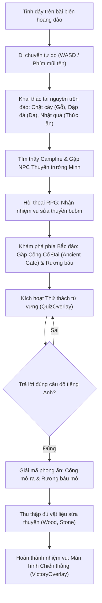

# Game Module: Word Island (2D Pixel-art Survival RPG)

**Word Island** là tựa game nhập vai phiêu lưu sinh tồn góc nhìn từ trên xuống (Top-down 2D Pixel-art RPG), nơi người chơi dạt vào một hòn đảo bí ẩn hoang vu, phải khai thác tài nguyên sinh tồn, hỗ trợ thuyền trưởng gặp nạn và giải các câu đố từ vựng cổ xưa để sửa thuyền trở về đất liền.

---

## Trạng thái hiện tại (Status)

- **Trạng thái**: ✅ **Đã hoàn thiện vòng lặp lối chơi cốt lõi (Core Gameplay Loop Playable)**.
- **Nền tảng tối ưu**: Desktop / Laptop (sử dụng phím `WASD` hoặc Mũi tên & phím `[E]` để tương tác).
- **Trải nghiệm**: Canvas đồ họa 2D thời gian thực với tỷ lệ khung hình 20:14 chuẩn mực retro (`800x560` resolution, phong cách pixelated).

---

## Vòng lặp lối chơi (Core Gameplay Loop)



---

## Các cơ chế gameplay chi tiết

### 1. Đồ họa Pixel-Art & Rendering Engine

- Thế giới trò chơi được xây dựng trên ma trận ô vuông (Tilemap $20 \times 14$ ô, mỗi ô $40 \times 40$ px).
- Hệ thống địa hình đa dạng: Vùng biển sâu cản đường (`Water`), bờ cát vàng (`Sand`), thảm cỏ xanh (`Grass`), và đường mòn đất (`Dirt Path`).
- Bộ dựng đồ họa Canvas thời gian thực (`src/utils/wordIslandRenderer.ts`) sử dụng `requestAnimationFrame`, tối ưu hóa hiệu năng render mượt mà 60 FPS.

### 2. Điều khiển nhân vật & Hệ thống va chạm (Collision Detection)

- Điều khiển nhân vật di chuyển 8 hướng mượt mà với gia tốc bằng cụm phím:
  - Di chuyển: `W`, `A`, `S`, `D` hoặc các phím mũi tên `↑`, `←`, `↓`, `→`.
  - Tương tác: Nhấn phím `E` hoặc phím `Space` khi đứng gần vật thể.
- Hệ thống va chạm dạng Axis-Aligned Bounding Box (AABB) ngăn người chơi đi xuyên qua rặng đá, cây cổ thụ, lều trại hay mép biển.

### 3. Cơ chế Khai thác & Sinh tồn (Resource Gathering)

- Trên đảo bố trí ngẫu nhiên các thực thể tự nhiên có thể tương tác:
  - **Cây thông / Cây dừa (`Pine Tree`)**: Tiếp cận và tương tác để thu thập **Gỗ (Wood)**.
  - **Mỏ đá Granite (`Granite Rock`)**: Tiếp cận và khai thác để thu thập **Đá (Stone)**.
  - **Bụi cây quả dại**: Nhặt quả mọng để bổ sung **Thức ăn (Food)**.
- Mỗi vật thể sau khi khai thác sẽ cạn kiệt tài nguyên và cập nhật trực tiếp vào hòm đồ (Inventory).

### 4. Hệ thống Hội thoại RPG (`DialogueOverlay`)

- Gặp gỡ NPC **Thuyền trưởng Minh (Captain Minh)** bị đắm tàu tại khu trại lửa giữa đảo.
- Hộp thoại tương tác phong cách RPG cổ điển với ảnh đại diện nhân vật, dẫn dắt người chơi qua các đoạn hội thoại có phân nhánh và giao nhiệm vụ sửa thuyền.

### 5. Thử thách Giải đố từ vựng (`QuizOverlay`)

- Phía Bắc hòn đảo bị phong ấn bởi **Cổng Cổ Đại (Locked Ancient Gate)** và các **Rương Tiếp Tế (Supply Chest)** bị khóa ma pháp.
- Để mở khóa, người chơi phải vượt qua thử thách ngôn ngữ:
  - Các câu hỏi trắc nghiệm kiểm tra từ vựng, ngữ pháp và nghĩa theo ngữ cảnh tiếng Anh.
  - Giao diện câu đố retro hiển thị các lựa chọn đáp án trực quan; trả lời đúng sẽ giải mã phong ấn, mở toang cánh cổng dẫn sang khu vực mới và mở khóa hòm báu.

### 6. Quản lý nhiệm vụ & Màn hình Chiến thắng (`VictoryOverlay`)

- **HUD thông minh (`GameHud`)**:
  - Khung Objective Banner hiển thị nhiệm vụ hiện tại (ví dụ: _Thu thập 3 Gỗ_, _Nói chuyện với Thuyền trưởng_, _Mở Cổng Cổ Đại_).
  - Khung Inventory hiển thị số lượng Gỗ, Đá và Thức ăn hiện có.
- **Victory Screen**: Khi hoàn tất sửa chữa thuyền buồm và vượt qua cổng thiêng, màn hình chiến thắng hoành tráng sẽ kích hoạt, vinh danh người chơi đã chinh phục thành công Word Island.

### 7. Menu Tạm dừng & Hỗ trợ (`PauseOverlay`, `TopBar`)

- Nhấn phím `Escape` hoặc nút Pause trên thanh `TopBar` để tạm dừng game, tra cứu lại bảng hướng dẫn phím bấm, hoặc chọn Restart để bắt đầu lại hòn đảo mới.

---

## Kiến trúc mã nguồn & Tệp tin liên quan

```text
src/
├── app/game/word-island/
│   └── page.tsx              # Server Component: Kiểm tra UserAgent, MobileWarning wrapper
├── pages/
│   └── WordIsland.tsx        # Main Game View: Container, quản lý Canvas và Modal overlays
├── components/word-island/
│   ├── GameHud.tsx           # HUD hiển thị mục tiêu nhiệm vụ, tài nguyên hòm đồ và nút [E]
│   ├── DialogueOverlay.tsx   # Modal hội thoại RPG với Thuyền trưởng Minh
│   ├── QuizOverlay.tsx       # Modal thử thách đố từ vựng để mở cổng/mở rương
│   ├── VictoryOverlay.tsx    # Màn hình chúc mừng chiến thắng khi sửa xong thuyền
│   ├── PauseOverlay.tsx      # Menu tạm dừng, hướng dẫn điều khiển & chơi lại
│   └── TopBar.tsx            # Thanh điều hướng trên cùng (Quay lại, Tạm dừng, Reset)
├── hooks/
│   └── useWordIsland.ts      # Game loop, xử lý di chuyển nhân vật, tương tác vật thể
├── stores/
│   └── wordIslandStore.ts    # Zustand store quản lý inventory, quest stage, dialogue, quiz
├── types/
│   └── wordIsland.ts         # TypeScript Interfaces: Player, WorldObject, Inventory, Quest
└── utils/
    ├── wordIslandRenderer.ts # Bộ vẽ đồ họa Canvas pixel-art 2D (Tilemap, nhân vật, animation)
    └── wordIslandData.ts     # Ma trận bản đồ đảo (ISLAND_MAP), tọa độ vật thể & câu đố
```

---

## Data Models chính

```typescript
// Giai đoạn nhiệm vụ chính
export type QuestStage =
  | "GATHER_WOOD" // Thu thập gỗ
  | "TALK_CAPTAIN" // Trò chuyện với Thuyền trưởng Minh
  | "ANCIENT_GATE" // Giải đố mở Cổng Cổ Đại
  | "VICTORY"; // Hoàn thành xuất sắc

// Túi đồ tài nguyên
export type Inventory = {
  wood: number; // Số lượng gỗ hiện có
  stone: number; // Số lượng đá hiện có
  food: number; // Số lượng thức ăn
};

// Vật thể trên bản đồ đảo
export type WorldObject = {
  id: string;
  type: "tree" | "rock" | "camp" | "npc" | "gate" | "chest";
  x: number;
  y: number;
  width: number;
  height: number;
  solid: boolean; // Có cản đường nhân vật hay không
  label: string;
  opened?: boolean; // Đã mở (đối với rương, cổng)
};

// Dữ liệu câu đố từ vựng mở phong ấn
export type VocabQuestion = {
  id: string;
  prompt: string; // Câu hỏi gợi ý
  options: string[]; // 4 lựa chọn trắc nghiệm
  correct: number; // Index của đáp án đúng (0 - 3)
  reward: {
    wood?: number;
    stone?: number;
    food?: number;
  };
};
```
