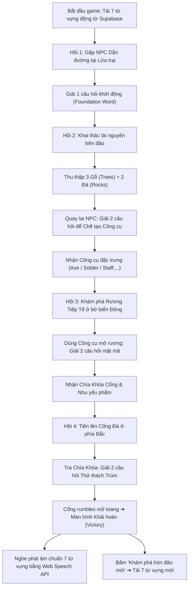

# Game Module: Word Island (2D Pixel-art Survival RPG & Dynamic Narrative)

**Word Island** là tựa game nhập vai phiêu lưu sinh tồn góc nhìn từ trên xuống (Top-down 2D Pixel-art RPG). Người chơi vào vai một Nhà thám hiểm dạt vào các quần đảo bí ẩn, phải khai thác tài nguyên thiên nhiên, hỗ trợ các NPC dẫn đường và giải mã các câu đố ngữ cảnh tiếng Anh qua **Mạch truyện 4 Hồi** để mở Cổng Cổ Đại và chinh phục hòn đảo.

Toàn bộ kịch bản, lời thoại NPC và câu hỏi trong game được **tự động sinh động từ kho dữ liệu 500 từ vựng và ngân hàng câu hỏi trắc nghiệm** trên cơ sở dữ liệu Supabase, mang lại giá trị học tập thực tế và khả năng chơi lại vô hạn (infinite replayability).

---

## Trạng thái hiện tại (Status)

- **Trạng thái**: ✅ **Hoàn thiện 100% Logic Trò chơi & Cốt truyện Nhiệm vụ Động (Full Dynamic Quest Loop Playable)**.
- **Nền tảng tối ưu**: Desktop / Laptop (sử dụng phím `WASD` hoặc Mũi tên & phím `[E]` / `Space` để tương tác).
- **Tích hợp dữ liệu thật**: Tự động kết nối bảng `vocabulary`, `topic_vocabulary`, `exercise_questions` trên Supabase để bốc ngẫu nhiên 7 từ vựng và 7 câu hỏi ngữ cảnh mỗi ván chơi.
- **Offline / Fallback Resilience**: Tích hợp sẵn `DEFAULT_FALLBACK_QUEST` với 7 từ vựng chuẩn chỉnh, đảm bảo game tải ngay lập tức kể cả khi mạng chậm hoặc người dùng chưa đăng nhập.
- **Phát âm đàm thoại**: Màn hình Victory tích hợp Web Speech Synthesis API hỗ trợ nghe phát âm chuẩn Anh - Mỹ cho toàn bộ từ vựng đã học.

---

## 8 Quần đảo & Cốt truyện theo Chủ đề (The 8 Island Realms)

Mỗi lần bắt đầu chơi hoặc bấm **"Khám phá hòn đảo mới"**, hệ thống sẽ tự động ngẫu nhiên chọn 1 trong các quần đảo chủ đề:

| Mã Chủ Đề | Tên Quần Đảo (Realm) | NPC Dẫn Đường | Bối Cảnh & Nguy Cơ | Công Cụ Chế Tác | Cổng Thoát Hiểm |
| :--- | :--- | :--- | :--- | :--- | :--- |
| **`animals`** | **Đảo Sinh Tồn Muông Thú**<br/>*(Fauna Sanctuary)* | **Kiểm lâm Hải**<br/>*(Wildlife Ranger)* | Bão lớn phá hỏng hàng rào trạm bảo tồn. Thu thập vật liệu, tìm hiểu tập tính muông thú để sửa chữa trạm an toàn. | **Móc Cứu Hộ Động Vật**<br/>*(Rescue Hook)* | **Cổng Bảo Tồn An Toàn** |
| **`tech`** | **Quần Đảo Cơ Khí**<br/>*(Cyber Atoll)* | **Kỹ sư Echo**<br/>*(AI Systems Engineer)* | Sự cố điện áp cô lập máy chủ trạm chuyển tiếp. Thu thập linh kiện và giải mã câu lệnh máy tính để tái khởi động mạng lõi. | **Mỏ Hàn Laser**<br/>*(Laser Solder Tool)* | **Cổng Tường Lửa Bảo Mật** |
| **`space`** | **Vùng Đất Tinh Cầu**<br/>*(Astral Reef)* | **Nhà Thiên văn Orion**<br/>*(Cosmic Explorer)* | Mảnh thiên thạch vũ trụ làm hỏng đèn dẫn đường quỹ đạo. Thu thập khoáng thạch và giải mã thuật ngữ thiên văn. | **Cuốc Khai Khoáng Lượng Tử**<br/>*(Quantum Pickaxe)* | **Cổng Dịch Chuyển Ngân Hà** |
| **`weather`** | **Đảo Bão Tố Vĩnh Cửu**<br/>*(Tempest Haven)* | **Nhà Khí tượng Phong**<br/>*(Storm Chaser)* | Áp suất khí quyển giảm mạnh báo hiệu lốc xoáy. Thu thập gỗ đá gia cố và làm chủ từ vựng thời tiết để kích hoạt trạm khí tượng. | **Rìu Gia Cố Bão**<br/>*(Storm Cleaver Axe)* | **Cổng Trạm Khí Tượng Cổ** |
| **`sports`** | **Đấu Trường Dũng Giả**<br/>*(Champion's Shore)* | **Huấn luyện viên Hùng**<br/>*(Master Coach)* | Thao trường rèn luyện của các nhà vô địch. Vượt qua thử thách thể lực và làm chủ từ vựng thể thao để chứng minh bản lĩnh. | **Búa Rèn Luyện Thể Lực**<br/>*(Athletic Hammer)* | **Cổng Đấu Trường Đỉnh Cao** |
| **`action`** | **Mỏm Đá Hành Động**<br/>*(Action Ridge)* | **Đội trưởng Thép**<br/>*(Frontier Captain)* | Địa hình hiểm trở đòi hỏi quyết định dứt khoát. Thu thập nguyên liệu, vượt vách đá và làm chủ các động từ hành động mạnh mẽ. | **Rìu Dã Ngoại Chiến Thuật**<br/>*(Tactical Camp Axe)* | **Cổng Tiền Đồn Phòng Thủ** |
| **`emotions`** | **Ốc Đảo Tâm Thức**<br/>*(Whispering Oasis)* | **Hiền giả Thu**<br/>*(Guardian of Harmony)* | Cột đá tâm linh bị vây quanh bởi năng lượng bất an. Thấu hiểu cảm xúc, giải mã câu đố để trả lại sự bình yên cho ốc đảo. | **Trượng Khai Sáng Tâm Thức**<br/>*(Staff of Clarity)* | **Cổng Tâm Thức Bình Yên** |
| **`default`** | **Đảo Sinh Tồn Bí Ẩn**<br/>*(Mysterious Word Island)* | **Thuyền trưởng Minh**<br/>*(Island Survivor)* | Tàu thám hiểm bị đắm dạt vào hoang đảo. Thu thập gỗ đá, chế tạo công cụ sinh tồn và giải mã cổ ngữ để thoát khỏi đảo. | **Rìu Đá Sinh Tồn**<br/>*(Stone Survival Axe)* | **Cổng Đá Cổ Đại** |

---

## Mạch truyện 4 Hồi trong mỗi ván chơi (4-Act Quest Loop)

Mỗi ván chơi sẽ chọn ra đúng **7 từ vựng** và phân bổ đều đặn vào 4 giai đoạn nhiệm vụ kịch tính:



### Chi tiết 4 Hồi:

1. **Hồi 1: Tiếp Đất & Gặp Nhân Vật Dẫn Đường (`TALK_TO_NPC`)**:
   - Người chơi tiếp cận NPC dẫn đường tại lửa trại trung tâm.
   - NPC giới thiệu bối cảnh nguy cơ của hòn đảo (song ngữ Anh - Việt).
   - Thử thách 1: Người chơi trả lời **1 câu hỏi trắc nghiệm ngữ cảnh khởi động** (`act1_intro`).
   - Hoàn thành: NPC giao nhiệm vụ thu thập nguyên liệu trên đảo.

2. **Hồi 2: Khai Thác Tài Nguyên & Chế Tạo Công Cụ (`GATHER_RESOURCES` ➔ `CRAFT_PUZZLE`)**:
   - Người chơi di chuyển quanh đảo, ấn `[E]` để chặt cây (thu thập 3 Gỗ) và đập đá (thu thập 2 Đá).
   - Tên tài nguyên song ngữ bay lên sinh động (`+1 Wood (Gỗ)`, `+1 Stone (Đá)`).
   - Mang đủ 3 Gỗ + 2 Đá về gặp NPC: NPC kích hoạt thử thách chế tạo gồm **2 câu hỏi trắc nghiệm ngữ cảnh** (`act2_craft`).
   - Hoàn thành: Chế tạo thành công công cụ đặc trưng của chủ đề (ví dụ: *Móc Cứu Hộ*, *Mỏ Hàn Laser*, *Rìu Đá*).

3. **Hồi 3: Giải Mã Rương Tiếp Tế Cổ Đại (`UNLOCK_CHEST`)**:
   - Người chơi di chuyển sang bờ biển phía Đông để tiếp cận Rương Tiếp Tế.
   - Nếu chưa có công cụ chế tạo, rương sẽ nhắc nhở cần quay lại gặp NPC.
   - Khi có công cụ, rương kích hoạt thử thách gồm **2 câu hỏi trắc nghiệm ngữ cảnh** (`act3_chest`).
   - Hoàn thành: Rương mở ra, trao **Chìa Khóa Cổng** và nhu yếu phẩm cho người chơi.

4. **Hồi 4: Thử Thách Trùm Tại Cổng Đá & Thoát Khỏi Đảo (`UNLOCK_GATE` ➔ `VICTORY`)**:
   - Người chơi di chuyển lên vòm đá phía Bắc hòn đảo.
   - Tra Chìa Khóa Cổng vào ổ: Cổng cổ đại phát sáng những ký tự rực rỡ và kích hoạt thử thách cuối gồm **2 câu hỏi trắc nghiệm tổng hợp** (`act4_gate`).
   - Hoàn thành: Cổng đá mở ra, nhân vật thoát khỏi đảo thành công!

5. **Màn hình Khải Hoàn (`VictoryOverlay`)**:
   - Hiển thị danh thiếp của toàn bộ 7 từ vựng đã học trong ván chơi: Từ tiếng Anh, phiên âm quốc tế IPA, từ loại, nghĩa tiếng Việt và câu ví dụ ngữ cảnh.
   - Tích hợp nút loa 🔊 bấm nghe phát âm tiếng Anh chuẩn (Text-to-Speech) từng từ.
   - Thống kê EXP thưởng (+70 EXP) và tỷ lệ độ chính xác.
   - Nút **"↺ Khám phá hòn đảo mới"**: Khởi tạo lại trò chơi và tự động bốc 7 từ vựng mới từ kho dữ liệu.

---

## Kiến trúc mã nguồn & Tệp tin liên quan

```text
src/
├── app/game/word-island/
│   ├── page.tsx                  # Server Component: Kiểm tra UserAgent, hiển thị MobileWarning nếu dùng mobile
│   └── README.md                 # Tài liệu kỹ thuật chi tiết của game Word Island (file này)
├── pages/
│   └── WordIsland.tsx            # Main Game View: Container, điều phối Canvas và các Modal Overlay
├── services/
│   └── wordIslandService.ts      # Dịch vụ tải 7 từ vựng và câu hỏi từ Supabase, tự sinh nhiệm vụ 4 Hồi
├── stores/
│   └── wordIslandStore.ts        # Zustand store: Quản lý quest hiện tại, inventory, dialogue, quiz state
├── types/
│   └── wordIsland.ts             # TypeScript Interfaces: DynamicQuest, IslandTheme, QuestWordInfo, VocabQuestion
├── utils/
│   ├── wordIslandThemes.ts       # Định nghĩa 8 Quần đảo chủ đề và bộ DEFAULT_FALLBACK_QUEST
│   ├── wordIslandRenderer.ts     # Bộ dựng đồ họa Canvas pixel-art 2D (Tilemap, nhân vật, animation, camera)
│   └── wordIslandData.ts         # Ma trận bản đồ đảo (ISLAND_MAP) và tọa độ các thực thể (INITIAL_OBJECTS)
├── components/word-island/
│   ├── GameHud.tsx               # HUD: Hiển thị nhiệm vụ hiện tại, tên công cụ, tên đảo và hòm đồ
│   ├── DialogueOverlay.tsx       # Hộp thoại RPG song ngữ Anh - Việt với NPC
│   ├── QuizOverlay.tsx           # Modal trắc nghiệm ngữ cảnh (câu hỏi chứa ____, 4 lựa chọn, giải thích)
│   ├── VictoryOverlay.tsx        # Màn hình chiến thắng hiển thị 7 từ vựng, nút nghe phát âm và nút chơi lại
│   ├── PauseOverlay.tsx          # Menu tạm dừng, hướng dẫn phím bấm
│   └── TopBar.tsx                # Thanh điều hướng trên cùng (Quay lại, Tạm dừng, Chơi lại)
└── hooks/
    └── useWordIsland.ts          # Game loop 60 FPS, xử lý va chạm AABB, di chuyển và tương tác thực thể
```

---

## Data Models chi tiết

```typescript
// Định nghĩa chủ đề quần đảo
export interface IslandTheme {
  id: string;             // 'animals' | 'tech' | 'space' | 'weather' | 'sports' | 'action' | 'emotions' | 'default'
  name: string;           // Tên tiếng Việt của chủ đề
  realmTitle: string;     // Tên vùng đất hiển thị trên HUD / Victory
  mentorName: string;     // Tên NPC dẫn đường (ví dụ: 'Kiểm lâm Hải')
  mentorRole: string;     // Vai trò NPC (ví dụ: 'Wildlife Ranger')
  introStoryEn: string;   // Lời thoại mở đầu tiếng Anh
  introStoryVi: string;   // Lời thoại mở đầu tiếng Việt
  toolNameEn: string;     // Tên công cụ tiếng Anh
  toolNameVi: string;     // Tên công cụ tiếng Việt
  chestNameEn: string;    // Tên rương tiếng Anh
  chestNameVi: string;    // Tên rương tiếng Việt
  gateNameEn: string;     // Tên cổng thoát tiếng Anh
  gateNameVi: string;     // Tên cổng thoát tiếng Việt
}

// Thông tin từ vựng hiển thị trên Victory Screen
export interface QuestWordInfo {
  id: string;
  word: string;
  pronunciation: string;
  partOfSpeech: string;
  meanings: string[];
  exampleSentence?: string;
  exampleTranslation?: string;
  difficulty?: string;
}

// Cấu trúc nhiệm vụ động hoàn chỉnh cho một ván chơi
export interface DynamicQuest {
  theme: IslandTheme;
  words: QuestWordInfo[]; // 7 từ vựng của ván chơi
  puzzles: {
    act1_intro: VocabQuestion[]; // 1 câu hỏi hồi 1
    act2_craft: VocabQuestion[]; // 2 câu hỏi hồi 2
    act3_chest: VocabQuestion[]; // 2 câu hỏi hồi 3
    act4_gate: VocabQuestion[];  // 2 câu hỏi hồi 4
  };
}

// Câu hỏi trắc nghiệm ngữ cảnh trong game
export interface VocabQuestion {
  id: string;
  title: string;
  contextEn: string;
  contextVi: string;
  question: string;       // Câu chứa ____
  hintVi: string;
  wordId?: string;
  word?: string;
  options: VocabQuestionOption[];
}

export interface VocabQuestionOption {
  id: string;             // 'a' | 'b' | 'c' | 'd'
  text: string;
  isCorrect: boolean;
  explanationEn: string;
  explanationVi: string;
}
```

---

## Các phím điều khiển (Controls)

| Phím | Chức năng |
| :--- | :--- |
| `W` / `↑` | Di chuyển lên trên (North) |
| `S` / `↓` | Di chuyển xuống dưới (South) |
| `A` / `←` | Di chuyển sang trái (West) |
| `D` / `→` | Di chuyển sang phải (East) |
| `E` / `Space` | **Tương tác**: Chặt cây, đập đá, nói chuyện NPC, mở rương, mở cổng |
| `P` / `Esc` | Tạm dừng trò chơi (Pause) / Tiếp tục (Resume) |
